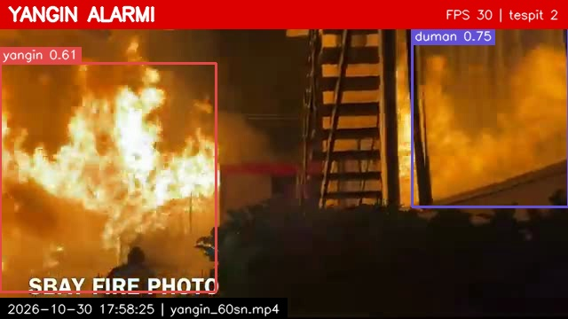
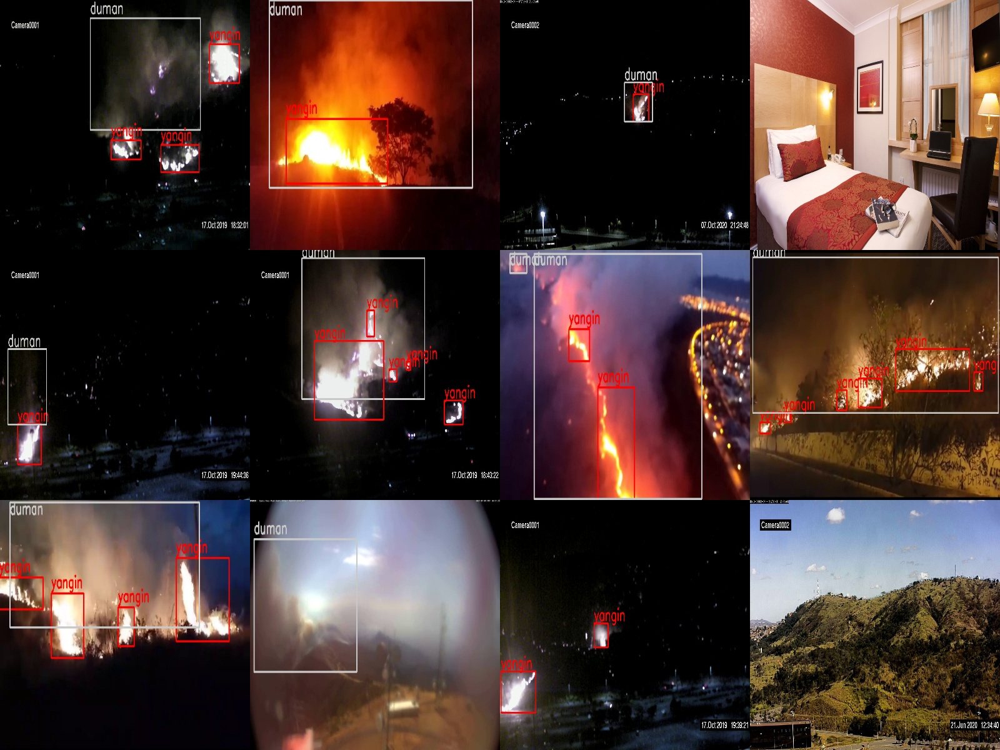

# Orman Yangını Erken Tespit Sistemi

Kamera görüntüsünde yangın ve dumanı gerçek zamanlı tespit eden, alarm veren ve her alarmı
fotoğraf + log olarak kaydeden sistem. YOLOv8 ve OpenCV ile yazıldı.



## Ne yaptık

- [D-Fire](https://github.com/gaiasd/DFireDataset) veri setinden 2035 görüntü seçildi ve %80/%20 bölündü. Sınıflar: `0 = yangin`, `1 = duman`.
- Modelin bulutları, gün batımını ve şimşeği yangın/duman sanmaması için 450 boş görüntü eklendi (eğitim 1988, doğrulama 497 görüntü).
- YOLOv8n modeli yangın ve duman için 50 tur eğitildi.
- Webcam veya video akışında canlı tespit ve sesli alarm. Son 1.5 saniyedeki karelerin en az %70'inde tespit varsa alarm verilir.
- 2 saniyede hiç değişmeyen kutular (tabela, fotoğraf) hareket kontrolüyle elenir.
- Her alarmın fotoğrafı ve log kaydı tutulur (aynı yangın için en fazla 10 saniyede bir).
- Sistem tek komutla çalışır.



Veri setinden örnekler. Kırmızı kutu: yangın, gri kutu: duman, kutusuz: yangın olmayan görüntü.

## Sonuçlar

Doğrulama seti (497 görüntü), en iyi model:

| | Precision | Recall | mAP50 | mAP50-95 |
|---|---|---|---|---|
| Genel | 0.816 | 0.712 | 0.801 | 0.487 |
| Yangın | 0.754 | 0.668 | 0.742 | 0.411 |
| Duman | 0.877 | 0.755 | 0.859 | 0.564 |

Eğitimde hiç kullanılmamış D-Fire test görüntüleri (1935 görüntü, 577'si boş), 40. tur:

| Precision | Recall | mAP50 | Yangın bulundu | Duman bulundu | Boş görüntüde yanlış tespit |
|---|---|---|---|---|---|
| 0.622 | 0.467 | 0.489 | %82 | %41 | %5 |

Video testleri, 20. tur:

| Video | Sonuç |
|---|---|
| Gece orman yangını, drone (4.5 dk) | İlk saniyede alarm |
| Duman görüntüsü (16 dk) | 5. saniyede alarm, sürenin %95'inde alarm açık |
| Sisli sabah, yangın yok (12 sn) | Alarm yok |
| Belgesel: duman bulutu ve orman yangını (3 dk) | Duman bulutunda alarm; yakın alevlerin bir kısmı kaçıyor; pembe çiçek tarlasında yanlış alarm |
| Sabit yangın fotoğrafı (15 sn, 50. tur) | Hareket kontrolü olmadan sürenin %97'sinde alarm, hareket kontrolüyle alarm yok |

Video testleri, 50. tur:

| Video | Sonuç |
|---|---|
| [FIRESENSE](https://zenodo.org/records/836749) duman videoları, sabit kameralar (13 dumanlı, 9 dumansız) | 13 videonun 7'sinde alarm; küçük ve ince beyaz duman kaçıyor. Dumansız 9 videonun 1'inde yanlış alarm |
| [FIRESENSE](https://zenodo.org/records/836749) alev videoları (11 alevli, 16 alevsiz) | 11 videonun 10'unda alarm. Alevsiz 16 videonun 4'ünde yanlış alarm: gece araba farları, yakın çekim ten rengi, puslu ağaçlar |
| [HPWREN](http://hpwren.ucsd.edu/) dağ kameraları, yangın başlangıcı (6 kayıt, dakikada 1 kare) | 4 kayıtta yangın başladıktan 10-34 dakika sonra tespit, 2 kayıtta hiç; ufuktaki küçük duman sütunları çoğunlukla kaçıyor. Yangından önceki 40 dakikada yanlış tespit yok |
| Kısa orman yangını klipleri (5 adet) | Alevli 3 klipte alarm; alevsiz ince duman ve söndürme uçağı sahnelerinde alarm yok |

Eğitimin her turunun değerleri ve grafikleri: [egitimler/asil/rapor/egitim_raporu.xlsx](egitimler/asil/rapor/egitim_raporu.xlsx)

Demo videosu: [ekran_goruntuleri/demo.mp4](ekran_goruntuleri/demo.mp4)

## Nasıl çalıştırılır

Kurulum (Python 3.9+):

```bash
python3 -m venv .venv
.venv/bin/pip install -r requirements.txt
```

Çalıştırma (`modeller/best.pt` gerekli):

```bash
.venv/bin/python main.py                                 # kamera
.venv/bin/python main.py --kaynak videolar/video.mp4     # video dosyası
```

Çıkmak için pencerede `q`. Alarmlar `alarmlar/goruntular/` ve `alarmlar/log.txt` içine kaydedilir.
Eşikler ve diğer ayarlar `ayarlar.py` içindedir.

Veri setini oluşturma:

```bash
.venv/bin/python araclar/dfire_indir.py etiketli /tmp/dfire
.venv/bin/python araclar/veri_hazirla.py /tmp/dfire
.venv/bin/python araclar/bos_goruntu_ekle.py <aday_klasoru> --adet 450
```

Eğitim:

```bash
.venv/bin/python araclar/egit.py --tur 50 --ad asil
```

Test görüntülerinde ölçüm:

```bash
.venv/bin/python araclar/dfire_indir.py test /tmp/dfire_test
.venv/bin/python araclar/test_degerlendir.py /tmp/dfire_test "50. tur=modeller/best.pt"
```
