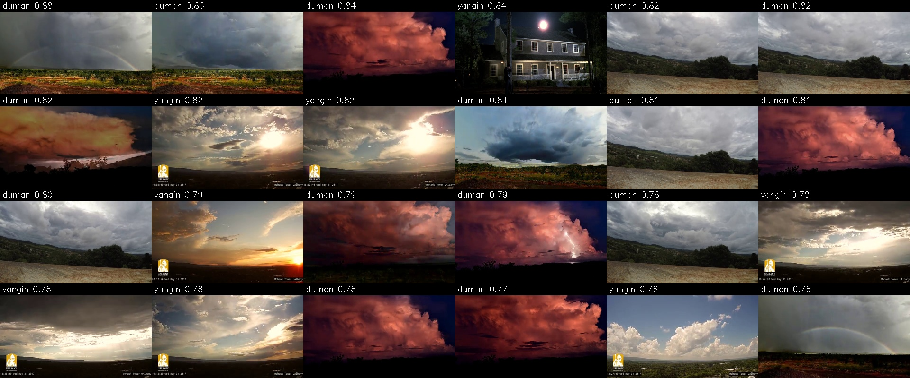

# Orman Yangını Erken Tespit Sistemi

Kamera görüntüsünde yangın ve dumanı gerçek zamanlı tespit edip alarm veren sistem.
YOLOv8 ve OpenCV ile geliştiriliyor.

## Ne yaptık

| Hafta | Yapılan |
|---|---|
| 1 | Python ortamı kuruldu, hazır YOLOv8 modeliyle webcam testi yapıldı |
| 2 | [D-Fire](https://github.com/gaiasd/DFireDataset) veri setinden 2035 görüntü seçildi, %80/%20 bölündü |
| 3 | YOLOv8n modeli yangın ve duman için 50 tur eğitildi; bulutları duman sanmaması için 450 boş görüntü eklendi |

## Sonuçlar

**Hafta 1:** Hazır YOLOv8 modeli webcam'de insan, telefon, bardak gibi nesneleri tanıyor.

**Hafta 2:** Eğitime hazır veri seti. Sınıflar: `0 = yangin`, `1 = duman`.

| | Eğitim | Doğrulama |
|---|---|---|
| Görüntü | 1628 | 407 |
| Boş görüntü | 153 | 28 |
| Yangın kutusu | 3043 | 946 |
| Duman kutusu | 1406 | 376 |


Kırmızı kutu: yangın, gri kutu: duman, kutusuz: yangın olmayan görüntü.

**Hafta 3:** Eğitilmiş model `modeller/best.pt`.

10. turdan sonra model bulutları, gün batımını ve şimşeği yangın/duman sanıyordu. Bu tür 450 boş görüntü
veri setine eklendi (eğitim 1988, doğrulama 497 görüntü).



10. turdaki modelin yangın olmayan görüntülerde yanlışlıkla gördüğü yangın/duman (bu görüntüler eğitime boş olarak eklendi).

Doğrulama seti (497 görüntü), en iyi model:

| | Precision | Recall | mAP50 | mAP50-95 |
|---|---|---|---|---|
| Genel | 0.816 | 0.712 | 0.801 | 0.487 |
| Yangın | 0.754 | 0.668 | 0.742 | 0.411 |
| Duman | 0.877 | 0.755 | 0.859 | 0.564 |

Eğitimde hiç kullanılmamış D-Fire test görüntüleri (1935 görüntü, 577'si boş), 40. tur:

| Precision | Recall | mAP50 | Yangın bulundu | Duman bulundu | Boş görüntüde yanlış tespit |
|---|---|---|---|---|---|
| 0.622 | 0.467 | 0.489 | %82 | %41 | %5 |

Eğitimin her turunun değerleri ve grafikleri: [egitimler/asil/rapor/egitim_raporu.xlsx](egitimler/asil/rapor/egitim_raporu.xlsx)

## Nasıl çalıştırılır

Kurulum (Python 3.9+):

```bash
python3 -m venv .venv
.venv/bin/pip install -r requirements.txt
```

Webcam testi (çıkmak için `q`):

```bash
.venv/bin/python testler/kamera_testi.py
```

Veri setini oluşturma:

```bash
.venv/bin/python araclar/dfire_indir.py etiketli /tmp/dfire
.venv/bin/python araclar/veri_hazirla.py /tmp/dfire
.venv/bin/python araclar/etiket_kontrol.py
```

Eğitim (50 tur; `--devam --oturum_turu 10` ile kaldığı yerden 10 tur):

```bash
.venv/bin/python araclar/egit.py --tur 50 --ad asil
```

Boş görüntü ekleme:

```bash
.venv/bin/python araclar/bos_goruntu_ekle.py <aday_klasoru> --adet 450
```

Test görüntülerinde ölçüm:

```bash
.venv/bin/python araclar/dfire_indir.py test /tmp/dfire_test
.venv/bin/python araclar/test_degerlendir.py /tmp/dfire_test "50. tur=modeller/best.pt"
```
